---

# Zoox Counts Protocol using Haemocytometer at ASU

Janna Hynds Last edited: 30/10/2026 by Janna Hynds

-   [Before Using the Microscope](#before-using-the-microscope)
-   [Before Doing Zoox Counts](#before-doing-zoox-counts)
-   [To Turn On the Microscope](#to-turn-on-the-microscope)
-   [Setting Up the Microscope](#setting-up-the-microscope)
    -   [Stage Inlays](#stage-inlays)
    -   [Focusing and Moving the Stage](#focusing-and-moving-the-stage)
    -   [Setting the Capture Folder](#setting-the-capture-folder)
-   [Using the Microscope](#using-the-microscope)
    -   [Brightfield and Fluorescence](#brightfield-and-fluorescence)
    -   [Exposure and Brightness](#exposure-and-brightness)
    -   [To Take Images](#to-take-images)
    -   [To Get the Images Off the
        iPad](#to-get-the-images-off-the-ipad)
-   [Preparing Your Samples](#preparing-your-samples)
-   [Calculating Symbiont Density Using
    ImageJ](#calculating-symbiont-density-using-imagej)
    -   [To Install CounZoox.ijm](#to-install-counzooxijm)
    -   [To Change Image Formats on
        ImageJ](#to-change-image-formats-on-imagej)
    -   [To Measure Images on ImageJ](#to-measure-images-on-imagej)
    -   [Recording Results in Excel](#recording-results-in-excel)
        -   [Density Calculation
            Reference](#density-calculation-reference)
-   [Symbiont Counts Analysis](#symbiont-counts-analysis)
    -   [Load Data](#load-data)
    -   [Creating New Data Frame with Necessary
        Columns](#creating-new-data-frame-with-necessary-columns)
    -   [Build New Data Frame](#build-new-data-frame)
    -   [Sorting by Treatment and
        Species](#sorting-by-treatment-and-species)
    -   [Symbiont Graph by Treatment](#symbiont-graph-by-treatment)


> **DISCLAIMER**
>
> This protocol is based on using the iPad-controlled Revolve microscope
> (shows on the iPad as **Revolve2-K2-1864**) in the Roger lab.
>
> This protocol also assumes the user knows how to work a basic
> microscope (e.g., knobs, stages, etc.).

# Before Using the Microscope {#before-using-the-microscope}

Before using the microscope, you have to schedule it with the Roger lab.
This is a shared Google calendar; request access from Dr. Liza Roger.

# Before Doing Zoox Counts {#before-doing-zoox-counts}

Make sure your samples thaw on ice so that when it comes time to use the
microscope, your samples are ready to go. You’ll need:

-   Kim wipes
-   Isopropanol or MQ
-   A couple of beakers for pipette tips and waste
-   Pipette and tips
-   Your haemocytometer

# To Turn On the Microscope {#to-turn-on-the-microscope}

Pull off the dust cover and open the iPad. The icon to power on the
microscope is in the home bar at the bottom of the iPad.

# Setting Up the Microscope {#setting-up-the-microscope}

## Stage Inlays {#stage-inlays}

There are two inlays you can use on the microscope: one for glass slides
and one that is circular. These sit on the shelf atop the microscope.
With the glass-slide inlay, you just have to balance the haemocytometer
properly so it doesn’t fall through.

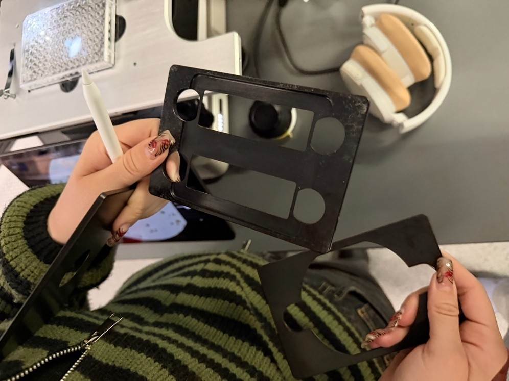

This is an **inverted microscope**, so when you load the haemocytometer,
you have to flip it upside down.

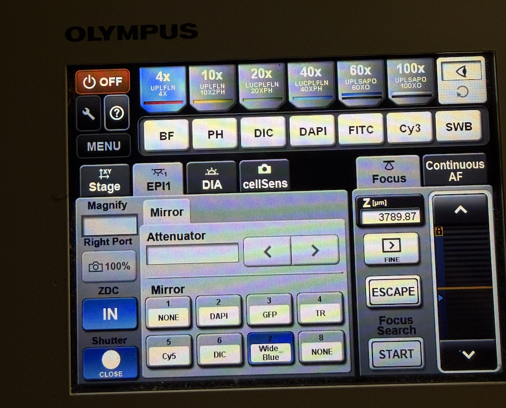

## Focusing and Moving the Stage {#focusing-and-moving-the-stage}

The focus knob is on the left of the microscope. The thicker band raises
and lowers the stage, and the top knob is for fine tuning.

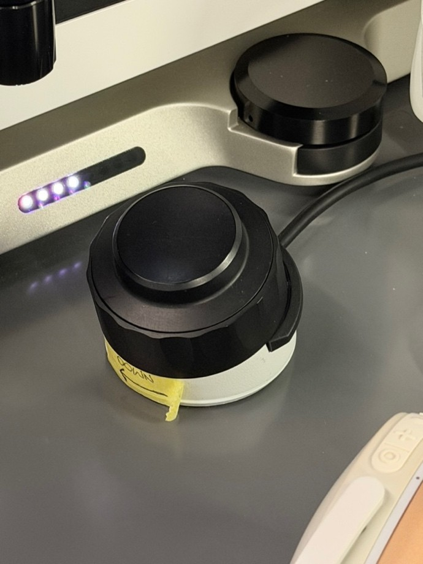

The lever/knob attached to the stage moves it side to side so you can
put your haemocytometer in the center.

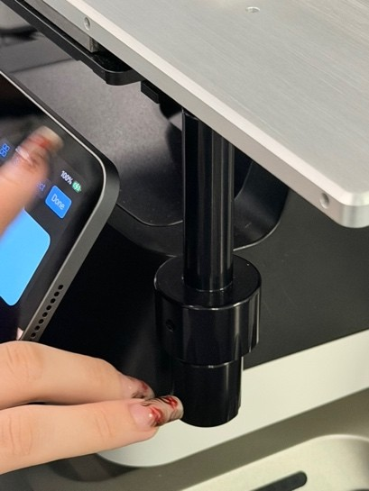

## Setting the Capture Folder {#setting-the-capture-folder}

In the top left of the iPad app, select the folder you will be saving
your images to. Our lab has a folder on the iPad currently titled
**MABEE**. **Make sure to select “Set as Capture Folder,”** or else your
images will save randomly.

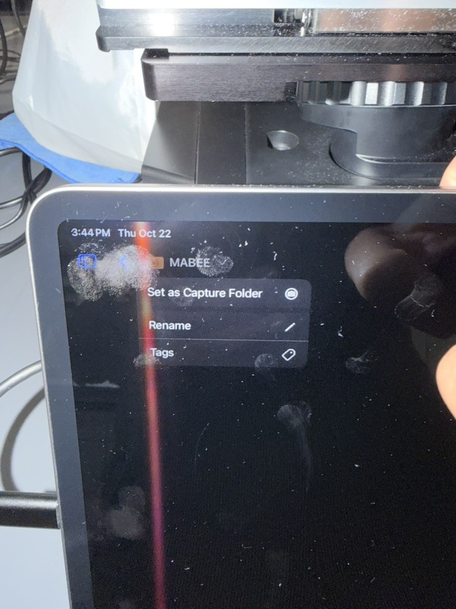

# Using the Microscope {#using-the-microscope}

## Brightfield and Fluorescence {#brightfield-and-fluorescence}

The top right of the screen has two buttons: **BF** (brightfield) and
**FL** (fluorescence).

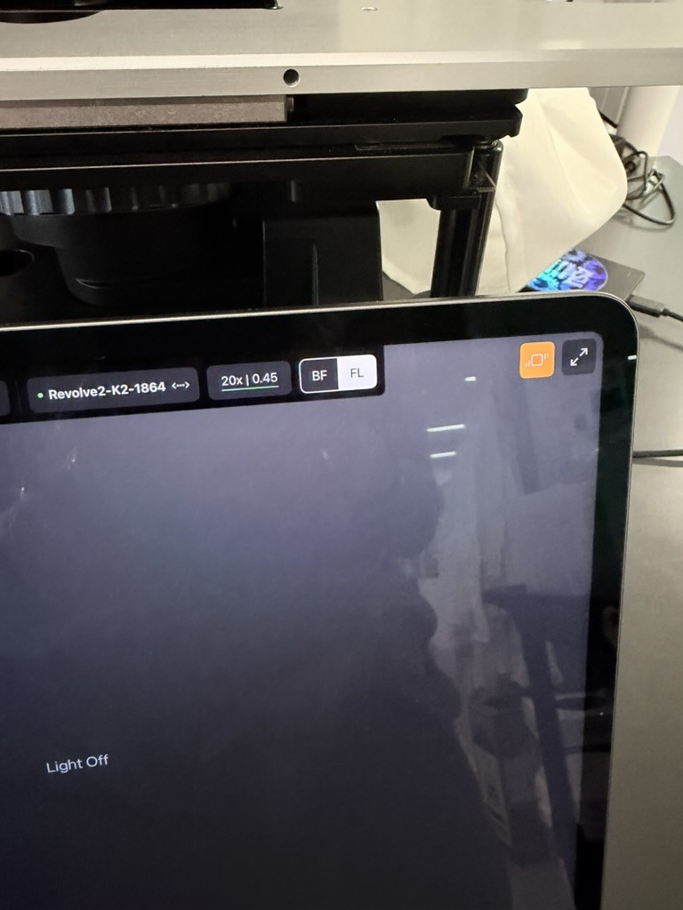

Use **brightfield** to focus your haemocytometer first and take a
picture of the grid. Then switch to **fluorescence** and try the
different channels along the bottom of the screen (DAPI, FITC, TRITC,
CY5, etc.). We use CY5 to highlight the symbionts red.

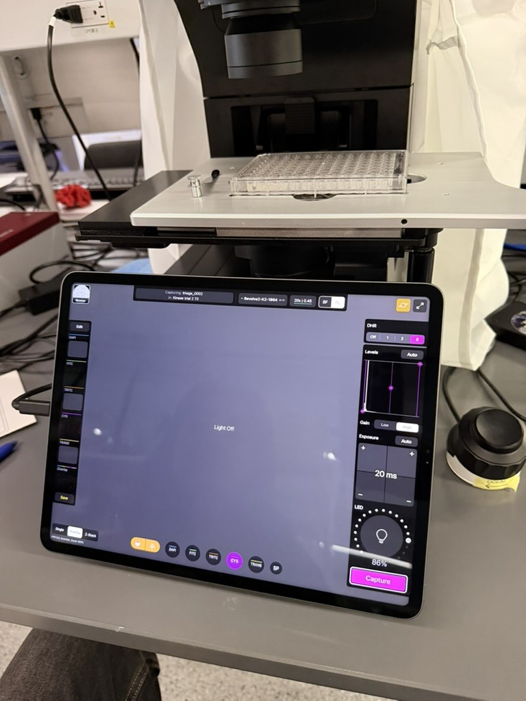

This is what the symbionts look like live on the iPad with CY5 selected:

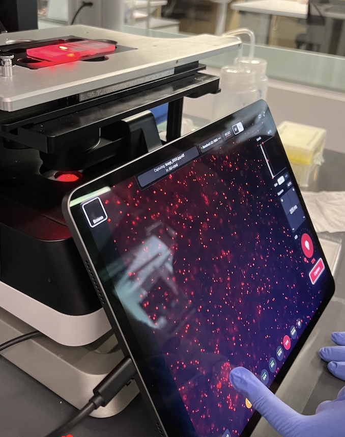

## Exposure and Brightness {#exposure-and-brightness}

You can adjust the exposure and brightness (LED) on the right panel.
**Make a note of the settings you use when you take each picture.**

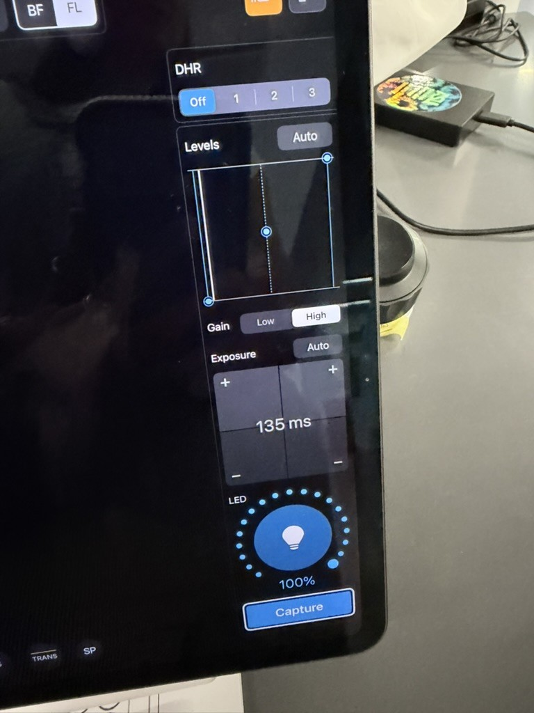

## To Take Images {#to-take-images}

When you’re ready to take a picture of your symbionts, hit **CAPTURE**.

Check that the images are saving properly to the MABEE lab folder, and
**write down which picture corresponds to which sample/triplicate.** The
name of the image is shown at the top of the screen, and you can also go
back and check it in the folder. This is very important!

Below is an example of what the symbionts should look like on the image.

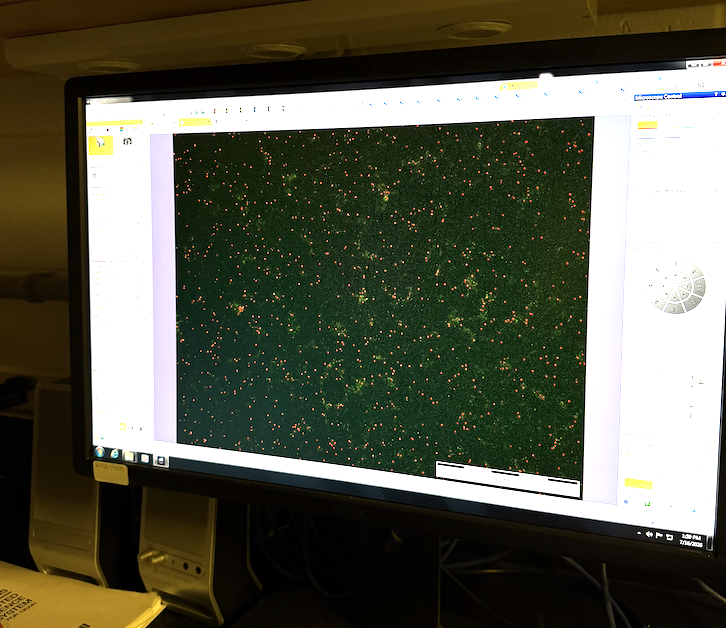

## To Get the Images Off the iPad {#to-get-the-images-off-the-ipad}

When you finish taking images, AirDrop them to your laptop or phone and
then put them in the Google Drive for safe keeping.

# Preparing Your Samples {#preparing-your-samples}

Your samples should be in slurry (rather than frozen) and ready to go
when the time comes to image the zoox counts (about an hour on the ice).

The following are materials you’ll need on the lab bench:

-   Kimwipes
-   Squirt bottle of MQ
-   2 large beakers (or something of similar shape)
-   Neubauer haemocytometer and coverslip
-   100–1000 µL pipette and tips
-   Samples on ice
-   Notebook to track samples and imaging

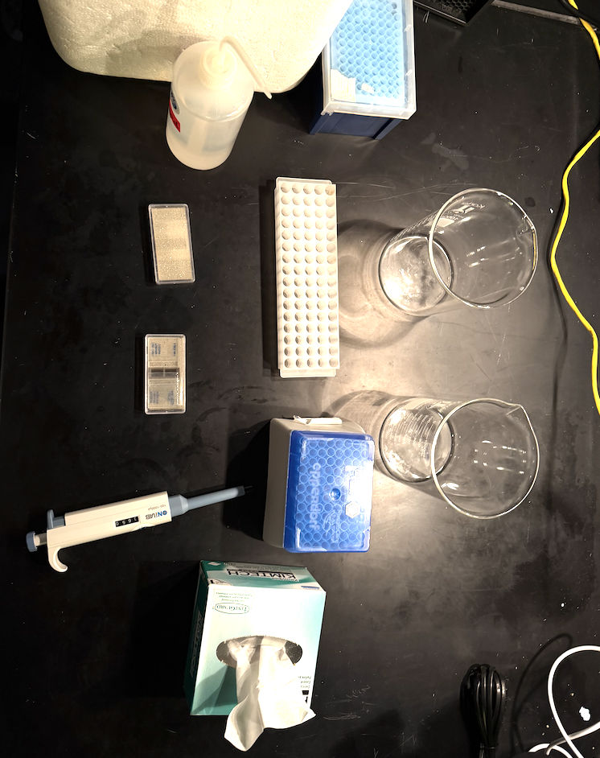

Once your samples are thawed, you can prepare your hemocytometer.

Place the coverslip on the center of the hemocytometer in the middle.

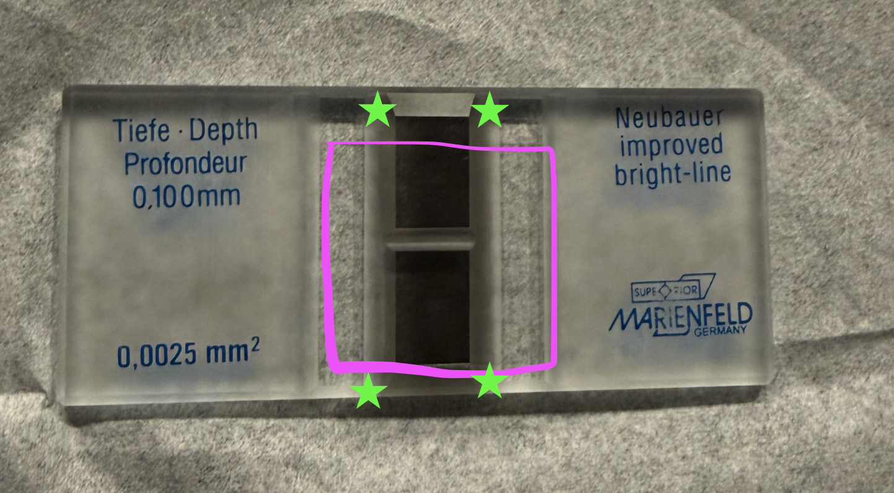
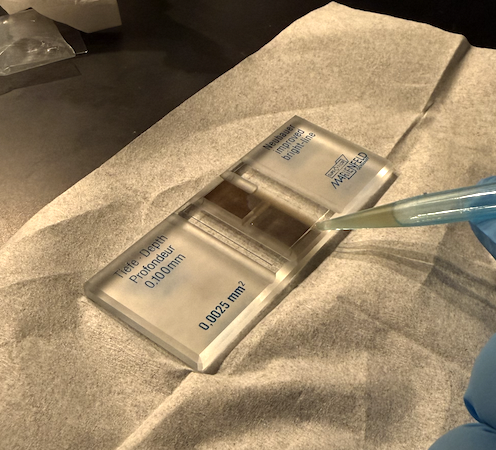

Invert your slurry a few times to mix up the zoox. There should not be a
pellet at the bottom — rather, everything should be in suspension, all
one slurry.

Fill your pipette with **200 µL** of slurry and insert it into the divot
marked with a red dot at around a **45-degree angle**. Press down on the
pipette slowly to inject your slurry into the haemocytometer and fill
both grey grids and side divots.

Be sure not to overfill, as sometimes the slurry will overflow on top of
the coverslip. The slurry will create surface tension between the
coverslip and the haemocytometer.

Also be sure not to have any bubbles, as this will sometimes condense
your cells into clumps, or lift the cover slide higher than the
calculated height.

When finished, flip the haemocytometer upside down, place it in the
inlay, and use the stage lever to center one of the grey grids under the
objective. Focus on the grid in brightfield before switching to
fluorescence.

When taking photos, be sure to take 2 — one on each grey grid/rectangle.
For the samples at ASU, we will be filling 2 haemocytometers with the
same sample (eg. 4 photos per sample). If the symbiont count looks
drastically different between these photos, do a 3rd haemocytometer of
the same sample (6 photos).

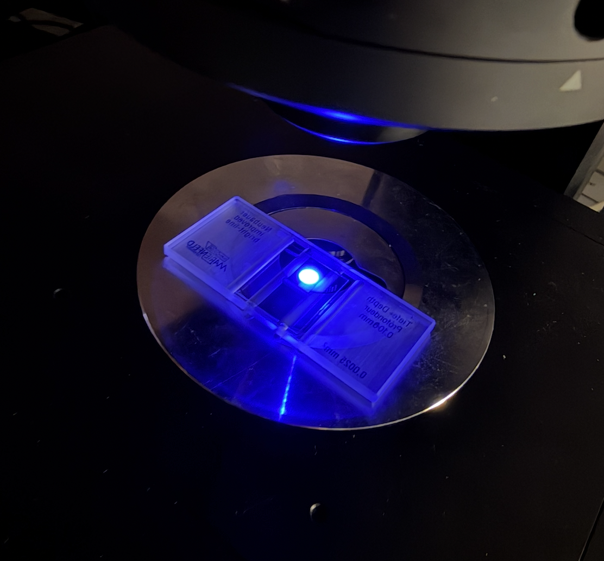

# Calculating Symbiont Density Using ImageJ {#calculating-symbiont-density-using-imagej}

Download ImageJ (Fiji): <https://imagej.net/software/fiji/downloads>

## To Install CounZoox.ijm

1.  Open ImageJ
2.  Plugins → Macros → Install → `CounZoox.ijm`

## To Change Image Formats on ImageJ {#to-change-image-formats-on-imagej}

Go to: Applications → Fiji (right-click) → Show Package Contents →
macros → (right-click) on CounZoox → Open Text Editor.

Look for the image types in the file, and add your type of image (e.g.,
`tif`, `TIF`, `TIFF`, `jpeg`, etc.).

## To Measure Images on ImageJ {#to-measure-images-on-imagej}

1.  Open image
2.  $$9$$ initiate variables and results table (Plugins → Macros → Init)
3.  $$0$$ to define parameters (Plugins → Macros → Edit parameters)
    1.  

        # channel to threshold: `1`

    2.  Alga threshold $$0 to reboot$$: `0`

    3.  Alga diameter $$min-max$$ in µm: `4-14`

    4.  \* range of min-max
4.  $$1$$ starts measuring

Plugins → Macros → Measure current

Confirm the threshold. Once you have measured one accurately, and you
are getting an accurate N.alga, you can batch measure your folder of
images:

Plugins → Macros → Batch → Select the folder with your images

## Recording Results in Excel {#recording-results-in-excel}

Your spreadsheet should have these headers/columns (give or take some
automated ones from the script). The columns marked **(script output)**
are the columns/counts that the script gives you.

| Directory | coral_ID | haemo_replicate | day | N.alga | C.Alga_per_pxl3 | Est_vol_pxl2 | Cam_Sz | Surface_um2 | Volume_um3 | zx_um3 | zx_mL |
|:---|:---|---:|:---|---:|---:|---:|:---|---:|---:|---:|---:|
| blahblah | M2_984 | 1 | D21 | 563 | 0.000390 | 1223680 | 1280x956 | 7648000 | 764800000 | 7e-07 | 736000 |
| blah | M2_984 | 2 | D21 | 639 | 0.000443 | 1223680 | 1280x956 | 7648000 | 764800000 | 8e-07 | 836000 |

Example counts spreadsheet (N.alga and C.Alga per pxl\^3 are script
outputs)

The grid on the haemocytometer is **3x3 mm**, so measure out 1 mm in
pixels.

The space between the coverslip and the microscope slide is 0.100 mm, or
100 µm.

*Example: We measured 433.0185 pixels per 1 mm, or (433.0185/1000) =
0.433 µm.* *Example: We measured 400 pixels per 1 mm, or (400/1000) =
0.400 µm.*

Your **Cam Sz** is the pixel dimensions of your image (e.g., 1280x956).
You can find this in ImageJ (Image → Show Info) or in the image file’s
properties on your computer.

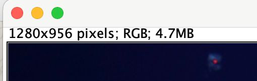

### Density Calculation Reference {#density-calculation-reference}

The following conversions and worked example (Cam Sz = 1280x956, N.alga
= 563) are used to go from a raw camera image to a symbiont density in
cells/mL.

-   1 mm = 400 pixels → 1 pixel = 0.0025 mm = 2.5 µm
-   1 pixel² = 6.25 µm²
-   `Surface_µm²` = `Est. vol. (pxl²)` × 6.25 µm²
-   `Volume_µm³` = `Surface_µm²` × 100 (the 100 µm coverslip-to-slide
    depth)
-   `zx_µm³` = `N.alga` / `Volume_µm³`
-   `zx_mL` = `zx_µm³` / 10⁻¹²

**Worked example (Cam Sz = 1280x956, N.alga = 563):**

| Quantity           | Value       |
|:-------------------|:------------|
| Est. vol. (pxl²)   | 1,223,680   |
| Surface_µm²        | 7,648,000   |
| Volume_µm³         | 764,800,000 |
| zx_µm³ (cells/µm³) | 7.36e-07    |
| zx_mL (cells/mL)   | 7.36e+05    |

You can reuse this calculation for any new image: just update the Cam Sz
(from the image’s top-left pixel dimensions) and N.alga (the
CounZoox.ijm output) to get zx_mL for that sample.

# Symbiont Counts Analysis {#symbiont-counts-analysis}

The section below takes the per-image `zx_mL` densities calculated above
(exported into a counts spreadsheet, one row per image/replicate) and
combines them with a coral surface-area spreadsheet to get symbiont
density normalized to coral surface area (`zx_cm2`), then compares that
across treatments and species. Update the file names, column names, and
day/treatment labels in the first chunk to match your own data set —
everything downstream is written generically off those columns.

``` r
# Packages needed for the analysis below:
#   dplyr    -> data wrangling (select/mutate/filter/join/group_by/summarise)
#   ggplot2  -> plotting
#   Rmisc    -> summarySE() for summary stats (mean, sd, se, CI) by group
library(dplyr)
library(ggplot2)
library(Rmisc)
```

## Load Data {#load-data}

``` r
# --- EDIT THESE FILE PATHS to point at your own exported CSVs ---
# sym_dat:      one row per image/replicate, with the zx_mL density calculated
#               in the "Density Calculation Reference" section above
# surface_area: one row per coral fragment, with its measured surface area
sym_dat      <- read.csv("SymbiontCounts2024_AUindoor.csv",
                          header = TRUE, stringsAsFactors = FALSE)
surface_area <- read.csv("Indoorfrags_SA.csv",
                          header = TRUE, stringsAsFactors = FALSE)

# Blank cells (e.g. "" or "  ") are read in as empty strings, not NA.
# Convert any blank/whitespace-only cell in either data frame to a proper NA
# so downstream numeric conversion and filtering (is.na()) work correctly.
sym_dat[]      <- lapply(sym_dat,      function(x) ifelse(trimws(x) == "", NA, x))
surface_area[] <- lapply(surface_area, function(x) ifelse(trimws(x) == "", NA, x))

# Quick sanity check of the imported surface-area data (column names/types)
str(surface_area)
```

## Creating New Data Frame with Necessary Columns {#creating-new-data-frame-with-necessary-columns}

``` r
# --- surface-area table ---
# Rename columns to a common naming scheme, coerce to the right types,
# and drop any fragment that has no surface-area measurement.
# EDIT the right-hand column names (frag_number, surface_areacm2, etc.)
# to match whatever your surface-area CSV actually calls them.
sa_cols <- surface_area %>%
  select(
    coral_ID     = frag_number,
    day,
    slurry_mL,
    treatment,
    species,
    surface_area = surface_areacm2
  ) %>%
  mutate(
    slurry_mL    = as.numeric(slurry_mL),
    surface_area = as.numeric(surface_area),
    day          = trimws(day),
    coral_ID     = trimws(coral_ID)
  ) %>%
  filter(
    !is.na(surface_area)
  )

# --- symbiont-count table ---
# Same idea: rename to the common naming scheme, coerce types, and keep
# only the sampling days you actually want to analyze.
# EDIT the column names on the right (coral_id, haemo_replicate, zx_mL)
# and the vector of day labels in filter() to match your own data set.
sym_cols <- sym_dat %>%
  select(
    coral_ID = coral_id,
    day,
    tissue   = haemo_replicate,
    zx_mL
  ) %>%
  mutate(
    zx_mL    = as.numeric(zx_mL),
    day      = trimws(day),
    coral_ID = trimws(coral_ID)
  ) %>%
  filter(
    day %in% c("D-8", "D21", "D46")   # EDIT: your own timepoint labels
  )
```

## Build New Data Frame {#build-new-data-frame}

``` r
# Join the symbiont counts to their matching coral's surface area (by
# coral_ID + day), then average zx_mL across replicates for each
# coral/day/treatment/species combination.
#
# Finally, convert density-per-mL-of-slurry into density-per-cm2-of-coral:
#   zx_cm2 = zx_mL * slurry_mL / surface_area / 1e5
# (the /1e5 rescales into units of 10^5 cells/cm2, matching the plot below)
zx_table <- sym_cols %>%
  left_join(sa_cols, by = c("coral_ID", "day"))

# Quick check: how many rows actually got a valid zx_cm2 value, and what
# does the overall distribution look like? (making sure you don't have NA or mismatch)
cat("\n--- zx per cm² summary (all days) ---\n")
print(summary(zx_table$zx_cm2))
cat("\nCalculated for", sum(!is.na(zx_table$zx_cm2)), "of", nrow(zx_table), "rows.\n")
```

## Sorting by Treatment and Species {#sorting-by-treatment-and-species}

``` r
# Subset to a single timepoint of interest (EDIT "D46" to your timepoint)
# and drop rows with no valid zx_cm2.
zx_D46 <- zx_table %>%
  filter(day == "D46", !is.na(zx_cm2))   # EDIT: day label to analyze

cat("\n--- D46 zx_cm2 summary ---\n")
print(summary(zx_D46$zx_cm2))
cat("Mean:", mean(zx_D46$zx_cm2, na.rm = TRUE), "x10^5 cells/cm²\n")
cat("n =", nrow(zx_D46), "\n")

# summarySE() (from Rmisc) computes n, mean, sd, se, and 95% CI of zx_cm2
# for each group -- once grouped only by treatment, and once by
# treatment + species, for whichever comparison you want to plot/report.
zx_sum_trt <- summarySE(data       = zx_D46,
                         measurevar = "zx_cm2",
                         groupvars  = "treatment",
                         na.rm      = TRUE)

zx_sum_sp  <- summarySE(data       = zx_D46,
                         measurevar = "zx_cm2",
                         groupvars  = c("treatment", "species"),
                         na.rm      = TRUE)

# EDIT these to your own treatment names/colors -- this just fixes the
# plotting order (trt_order) and assigns a consistent color per treatment
# (trt_colors) so every plot using this data uses the same scheme.
trt_order  <- c("ambient", "AU_8h", "heated")
trt_colors <- c("ambient" = "goldenrod1",
                 "AU_8h"   = "deepskyblue",
                 "heated"  = "firebrick2")

zx_D46$treatment     <- factor(zx_D46$treatment,     levels = trt_order)
zx_sum_trt$treatment <- factor(zx_sum_trt$treatment, levels = trt_order)
zx_sum_sp$treatment  <- factor(zx_sum_sp$treatment,  levels = trt_order)
```

## Symbiont Graph by Treatment {#symbiont-graph-by-treatment}

``` r
# Boxplot of symbiont density by treatment, with:
#  - individual points jittered on top (geom_jitter) so you can see spread
#  - a blue dot marking the group mean (stat_summary)
#  - a fixed color per treatment (trt_colors, defined above)
# EDIT the title/axis labels and trt_colors above to match your own study.
zx_graph_trt <- ggplot(zx_D46,
                       aes(x = treatment, y = zx_cm2, fill = treatment)) +
  geom_boxplot(outlier.shape = NA, alpha = 0.7, width = 0.5, color = "grey30") +
  geom_jitter(aes(color = treatment), width = 0.15, size = 2, alpha = 0.7) +
  stat_summary(fun = mean, geom = "point",
               shape = 20, size = 5, color = "blue", fill = "blue") +
  scale_fill_manual(values  = trt_colors) +
  scale_color_manual(values = trt_colors) +
  scale_x_discrete(guide = guide_axis(angle = 90)) +
  ylab(bquote('Symbiont density (' * 10^5 * ' cells cm'^-2 * ')')) +
  xlab("Treatment") +
  ggtitle("Indoor Symbiont Density by Treatment — D45") +
  theme_bw() +
  theme(legend.position = "left",
        plot.title      = element_text(face = "bold", hjust = 0.5))

print(zx_graph_trt)
```
